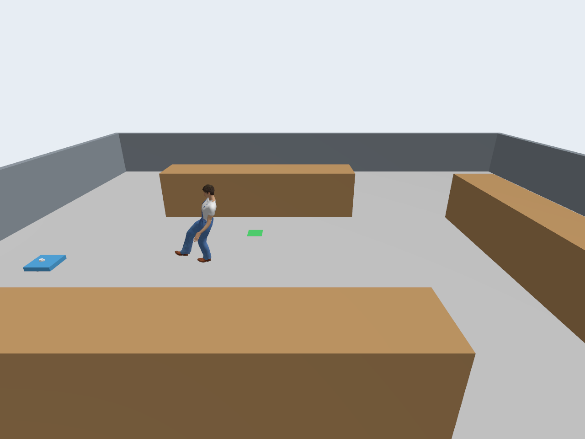

# 1 米/秒与 HuNav 行人模型（0.5.0）

日期：2026-10-28。本机 ROS 2 Lyrical / Gazebo Sim 10。

## 修改内容

- 行人巡航速度为 1.0 m/s，保持原路线 x=-4.0～2.8、y=0，靠近端点减速换向。
  行人只读取自身物理反馈和仿真时钟，不读取机器人位置，不主动停让。
- 小车的 MPPI `vx_max`、velocity_smoother `max_velocity[0]`、Gazebo DiffDrive
  `max_linear_velocity` 三处均设为 1.0 m/s。原底盘 0.46 m/s 的限制已被替换。
  前进加速度 1.0 m/s²、减速度上限 2.0 m/s² 同步配置。
  Nav2 在转弯、接近目标和遇障碍时仍会减速或停车，1 m/s 不是强制恒速。
- 局部代价地图为 8×8 米、20 Hz，全局障碍更新为 5 Hz，膨胀半径 1.1 米；
  减速/停车圈为 1.20/0.65 米。Nav2 保持对机器人运动的控制。
- 行人物理驱动保持有限推力。调整目标跟随距离，使实际运动能达到 1 m/s，
  并在物理行程端点前开始制动。允许独立时钟/关节桥接之间不超过 50 ms 的顺序偏差，
  避免把新鲜的反馈误判为过期而反复制动。

## 模型来自哪里

参考项目：[Summer-Research-2026](https://github.com/Albert-Ludwig/Summer-Research-2026)，
检查的提交为 `326ed17307f9c5b748c59a37538c52e260b8ea7a`。
其中 `office_2_agents.yaml` 使用 `skin: 4` 和 `skin: 3`；
HuNav WorldGenerator 将它们映射为 `worker_man.dae` 和 `regular_man.dae`。
本版选择工装男性 `worker_man.dae`。

模型取自项目记录的
[HuNav Gazebo wrapper](https://github.com/robotics-upo/hunav_gazebo_fortress_wrapper/tree/41f97f764df00303a85227911ec8173f0c25c758/worlds/models)，
固定提交为 `41f97f764df00303a85227911ec8173f0c25c758`。
安装包包含人物皮肤、walk.dae 行走动画、六张贴图、上游 MIT 许可证及 SHA256 清单，
运行时不需从 Fuel/GitHub 下载。
详细来源在 `src/inventory_inspection_poc/models/hunav_worker/SOURCE.md`。

Gazebo 自带 FollowActor 将骨骼动画人物同步到物理行人的实际位置；
它跟随的是行人物理模型，不是机器人。视觉高度按本机原生 Gazebo 坐标系调整为 0.85 米，
保证鞋底接近地面、低位雷达能观测到腿部。底层仍使用简化碰撞代理，未实现逐骨骼碰撞。
没有引入原项目的 HuNav 社会力控制或学习导航控制器。

下图为独立外观检查中从 Gazebo 相机直接保存的实际渲染帧：



## 最终运行验证

新启动的一轮任务全程未临时调整参数，结果见
[最终运行摘要](runtime/nav2-v0.5.0-one-mps-hunav.json)。

| 观测项 | 结果 |
|---|---|
| Home → A → B → C → Home | 完成，`acceptance_passed=true` |
| MPPI 实际最大前进命令 | 1.000 m/s |
| 机器人实际里程计最大线速度 | 1.000 m/s（约 1e-13 浮点误差） |
| 行人实际关节最大速度 | 1.000 m/s（约 1e-12 浮点误差） |
| 行人实际 x 范围 | -4.0～2.8 米（约 1e-12 浮点误差） |
| 任务仿真时间 | 161.540 秒 |
| A/B/C 静止停留 | 5.372 / 5.202 / 5.406 秒 |
| 碰撞事件 | 0，8/8 个接触话题注册 |
| 机器人参考坐标最大 z | 0.010007138 米，保持初始约 0.01 米 |
| 最大倾斜 | 0.000040344 弧度 |
| 最近人车参考点距离 | 1.128 米，不是表面间隙 |
| Nav2 控制器命令 | 2840 条 |
| Nav2 地图中行人障碍观测 | 58 次 |
| 回到 Home 的定位距离误差 | 0.07428 米 |

30 项 unittest、Python 编译、colcon 构建通过。测试覆盖所有贴图/网格文件的完整性、
行人独立控制、几何/范围检查、三层速度配置一致性及原任务失败处理。
还直接检查了从本机官方 SDF 生成的 DiffDrive 参数：速度上限确实为 1.0 m/s。

## 排查记录和验证范围

最初按旧项目的 1.25 米视觉高度接入时，鞋底悬空，代价地图没有观测到行人，
任务发生接触后被取消，见 [初次接入失败记录](runtime/nav2-v0.5.0-initial-height-failure.json)。
调整为 0.85 米并验证实际渲染、低位雷达观测后，才完成上面的最终任务。
初次控制器跟随距离也把行人的实际速度限制在约 0.406 m/s，已修正并重新实测。

部分隔离测试在高 ROS domain 下出现动作服务器发现失败。测试工具改用 50～94 的低范围，
并将 Nav2 动作服务器发现等待设为 10 秒。没有用这些启动失败的运行冒充任务通过。
原始最终日志在 `/tmp/nav2-mission-wanku9rd/`，可能被清理；摘要与预览已纳入 Git。

桌面合并启动曾卡在 Gazebo 世界发现，随后将服务器/RViz 与 Gazebo GUI 分开启动，
并使用新的 Gazebo 缓存目录与 transport partition。已确认任务进入自动导航。
服务器/RViz 服务名为 `inventory-nav2-sim`，Gazebo 窗口为 `inventory-nav2-gui`。
需要停止当前桌面场景时：

```bash
systemctl --user stop inventory-nav2-gui inventory-nav2-sim
```

本记录只验证这一轮速度、路线和模型；尚未完成三次独立重启重复验收，Jazzy 未运行。
